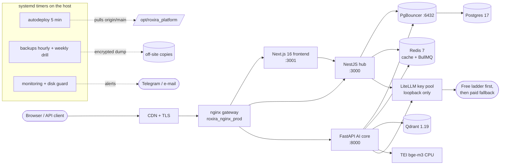
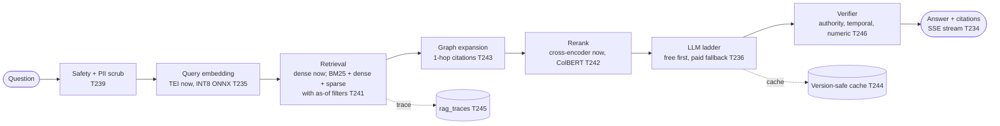
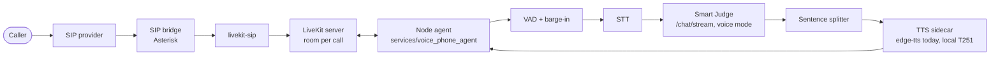
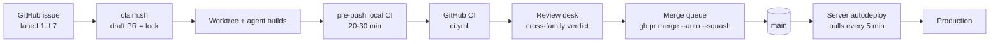

# Architecture (current, 2026-11-20)

One page per question: what runs, where the code lives, how data is protected, how work ships. Status lives in `docs/STATE.md`; the file-by-file inventory in `docs/SYSTEM_MAP.md`; derivable facts (compose, versions, model ids) in `docs/SYSTEM_INVENTORY.generated.md`. Rules for agents: `AGENTS.md`, `docs/agents/LESSONS.md`. If this file and the code disagree, the code wins: fix this file.

## 1. Products
| Product | What it is | Main code |
|---|---|---|
| **Roxira** | Multi-tenant CRM, ERP, accounting and tax suite. Behaviour that differs by country (chart of accounts, tax, e-invoicing, payment rails) is a **country pack**. Packs today: `ir` (live), `de`, `my`, `xx` (template). | `output_apps/enterprise_hub/` |
| **Smart Judge** | Legal assistant on the same stack: cited answers over a law corpus (chat), petitions and drafting, and a phone agent. Separate domain, own login, own plans. | `output_apps/generated_modules/smartjudge/`, `services/voice_phone_agent/` |

Product order (owner): Roxira product first (DE/EU, then Gulf), Smart Judge stays reliable while it earns. Direction and dates: `docs/STATE.md`.

## 2. Runtime topology (production server)
Everything below runs on one Docker Compose host (`docker-compose.prod.yml`), arm64, 4 vCPU / 7.7 GB RAM, repo at `/opt/roxira_platform`. Only ports 22, 80 and 443 are reachable (80/443 only from the CDN); compose publishes app ports on loopback.

- Compose services: `nginx_gateway`, `enterprise_app` (AI core), `roxira_enterprise_backend` (NestJS), `roxira_enterprise_frontend`, `postgres_prod`, `pgbouncer_prod`, `redis_prod`, `qdrant_prod`, `roxira_embeddings` (TEI), `docker-socket-proxy` (read-only Docker API for the owner console). The key pool (`roxira_keypool`, LiteLLM) is a separate compose project joined through the `roxira-keypool_default` network.
- Other containers kept outside this file: research stack (`services/research`), analytics, mail relay (Postfix + DKIM).
- Timers (`scripts/ops/`): autodeploy (`scripts/ops/autodeploy/`, backup, migrate, smoke, legal gate, rollback on failure), backups (`scripts/ops/backup/`: hourly encrypted pg_dump off-site, a second copy, Telegram copy, weekly restore drill), monitoring (synthetic checks, logs, daily report), disk guard, Qdrant replica, SBOM. Details: `docs/ops/AUTODEPLOY.md`, `docs/ops/DISASTER_RECOVERY.md`.
- Memory caps and OOM priority are set on every service (`docs/ops/MEMORY_BUDGET.md`). Trigger for a bigger server: RAM above 70% for 7 days (owner's spend).
- Secrets: `.env` on the server only, written with `scripts/ops/set_server_env.sh`.

## 3. Code layout
| Path | Owns |
|---|---|
| `output_apps/enterprise_hub/` | NestJS hub. `modules/<name>/` each with `controllers/`, `services/`, `dto/`, `repositories/`, `entities/`; `migrations/` (TypeORM, ordered by timestamp id); `app.module.ts` wires modules; `security/` guards. |
| `output_apps/enterprise_hub/modules/` | `accounting` (ledger, FX, ageing, money helper `money.ts`), `access` (`TenantScope`, RBAC, audit), `auth`, `tenants`, `crm`, `hr`, `inventory`, `invoicing`, `invoice_capture`, `sales`, `banking`, `treasury`, `cheques`, `tax_compliance`, `posting_rules`, `report_builder`, `data_import`, `approvals`, `assistant`, `public_api`, `radar`, `country_packs`, and others. |
| `modules/country_packs/` | Registry, resolver, interceptor and validation (`country-pack.*.ts`); one folder per pack (`ir/`, `de/` incl. `datev/`, `my/`, `xx/`); `payment_rails/` for settlement. Country behaviour goes here, never into core modules. |
| `output_apps/enterprise_hub/frontend/` | Next.js App Router, Tailwind, shadcn/ui. Pages in `src/app`, API clients in `src/lib/api/*-client.ts` (browser calls `/api/backend/...`), menu in `nav-menu.ts`. No service key may ever live here. |
| `output_apps/generated_modules/smartjudge/` | Python AI core: `llm_router.py`, `llm_gateway.py`, `model_registry.py`, `retrieval_contract.py`, `abstention_gate.py`, `reranker.py`, `answer_timing.py`, `chat_*.py`, drafting and auth modules, `legal_graph/` (LightRAG engine, ingestion). |
| `output_apps/nginx_config/` | Live nginx config mounted by compose. |
| `services/voice_phone_agent/` | Node phone agent (see section 7). `services/research`, `services/mail`, `services/analytics`, `services/migration_worker`: side services. |
| `config/` | `models.yaml` (model registry), `key_pool.yaml`. |
| `scripts/` | `dev/` (claim, local CI, review desk), `ci/` (guards), `ops/` (server, backups, CI box), `eval/`. |
| `docs/` | State, strategy rows (T-numbers), runbooks. |

NestJS rules (AGENTS.md): Controller-Service-DTO-Repository, a validated DTO on every endpoint, no database access in controllers, no circular imports, a new module must be imported in `app.module.ts` (LESSONS 3, 15). CI job `agent-guards` (`scripts/ci/check_agent_guards.py`) fails float math on money, raw queries on tenant tables, hard-coded model ids and plaintext secret columns.

## 4. Data and tenancy
- **Postgres 17** (`enterprise_db`) behind PgBouncer (transaction pooling). Redis for cache, rate limits and BullMQ. Qdrant for legal vectors. The AI core also keeps a small SQLite auth file.
- **Tenancy rule:** every new table has a `tenant_id` (or an owner column), `ENABLE` and `FORCE ROW LEVEL SECURITY`, and a tenant policy. Every query on a tenant table runs inside `TenantScope` (`modules/access/services/tenant-scope.ts`), including workers and crons. Tables read before the tenant is known (login, refresh, invites, public forms) get their own design. Never trust a client-supplied tenant id.
- **Production role:** the app should connect as the restricted `roxira_app` (NOSUPERUSER NOBYPASSRLS). Today it still connects as a superuser until the cutover T200 (#831); CI also runs as superuser, so pg specs must run real repository methods as the restricted role (LESSONS 5).
- **Money** is bigint minor units through `modules/accounting/money.ts`; the UI uses `formatMoneyRial`; no `Number()`, `parseFloat` or float division.
- **Migrations** land only through reviewed PRs, never directly on production. Ids must be above the newest on `origin/main` and every open PR (`scripts/dev/check_migration_ids.py --open-prs`); squawk lints them. The autodeploy runs them after a fresh backup.
- **Backups:** hourly encrypted dump off-site plus second copy and Telegram copy; weekly restore drill (Mac rehearsal today, moving to the CI box, T198); point-in-time recovery with WAL-G is built but not enabled (T204, #886).

## 5. Smart Judge pipeline
Today: a chat request flows through safety checks, query embedding (cached), hybrid retrieval over Qdrant plus SQL, rerank, citation-graph expansion, a free-first LLM ladder, and an abstention and citation gate. Every stage writes `answer_timing` (one JSON log line per answer, no question text). The retrieval interface is the `RetrievalBackend` contract in `retrieval_contract.py` (T211), so a hot stage can later move to Rust without a rewrite (`docs/strategy/ADR_RUST_READY_HOT_PATH.md`). Served corpus: Qdrant collection v6 (16 laws); v7b (60 laws) waits for T212.

R18 target (decision: phased Smart Judge v2 on the current server; digest `docs/strategy/research/R18_SMART_JUDGE.md`; rows are issues #973-#997):
| Area | Rows |
|---|---|
| Speed and streaming | T234 #973, T235 #974, T236 #975, T245 #984 |
| Retrieval quality | T237 #976, T238 #977, T241 #980, T242 #981, T243 #982, T257 #996, T258 #997 |
| Safety and answer checks | T239 #978, T246 #985, T244 #983 |
| Evaluation | T247 #986, T248 #987, T249 #988 |
| Phone agent | T250 #989, T251 #990 |
| Platform guards | T252 #991, T253 #992, T254 #993 (alert that triggers moving Smart Judge to its own server), T240 #979 |
| Refactor | T255 #994, T256 #995 |
Targets: first token <= 1.5 s p95, full answer <= 8 s p95, Recall@5 >= 0.95 on the 70-question gate.

## 6. Model policy
- Model ids and prices live only in `config/models.yaml`, read through `smartjudge/model_registry.py`; `python3 scripts/check_models.py` checks them against the live catalogue. Hard-coding an id fails CI.
- Product runtime roles: `free`, `cheap`, `strong`, `product*`, `stt`, `tts`, `vision`, `voice_realtime`. Builder roles: `architect`, `executor`, `reviewer`, `mechanical`.
- **Free first, paid as fallback** (owner decisions 2026-10-14 and 2026-11-16). Tenants with the paid private-data option are routed to paid models with data collection denied. Routing detail: `docs/strategy/MODEL_ROUTING_DECISION_2026-10-17.md`.
- Product calls go through the LiteLLM key pool, which chains paid ladders to the free ladder so answers continue when credit ends.
- R18 licence policy: runtime dependencies are MIT, Apache, BSD or PostgreSQL licensed (CI gate T252).

## 7. Phone stack (Linux box)
The Smart Judge phone line runs on the CI box, not on production, under its own Linux user `phone` with data in `/srv/data/phone`.

The agent joins only rooms with a SIP participant, ends on hang-up, idle or max duration, and authenticates to Smart Judge with a gateway key that has its own daily cap. Foreign APIs go through the box proxy; media and Smart Judge calls go direct. Deploy kit: `scripts/ops/ci_box/05_root_phone_stack.sh` (installs `voice-ai-agent` and `voice-ai-tts` units and a root-owned `phone-stack up|down|status|logs` wrapper). Next: fast STT and barge-in tuning (T250), local TTS and spoken numbers (T251). Known hardening gap: user `phone` is in the system `docker` group (root-equivalent).

## 8. Delivery

- **Lanes:** L1 ops/CI/infra, L2 frontend and currency, L3 security/data, L4 Smart Judge (Mac); L5 core ledger, L6 Germany then Gulf, L7 box and phone kit (Linux box). Prompts: `docs/antigravity/prompts/L1..L7.txt`. Order per lane: latest `## WAVE` comment on #592. At most 3 open PRs per lane.
- **Two machines** (`docs/TEAM_SPLIT_2026-11-17.md`): the Mac runs the **main hub** (strategy, WAVEs, review routing, merges L1-L4 and hub PRs, all production steps) and lanes L1-L4. The Linux box `roxira-ci` runs the **box hub** (merges L5-L7, box upkeep, phone stack), lanes L5-L7, and the self-hosted GitHub runner (rootless Docker, labels `self-hosted, Linux, X64, hp, linux-box`; workflows move over with #949). Hubs coordinate only through GitHub; box reports on #592 start with `BOX:`.
- **Builders:** Antigravity per lane; when its quota ends, Gemini CLI runs lanes L5-L7 in tmux (`scripts/ops/ci_box/gemini_lanes.sh`, started by hand only).
- **Gates:** pre-push `scripts/dev/local_ci.sh` (never `--no-verify`), GitHub `ci.yml` (change detection, secret scan, unit tests, frontend gate, agent guards, migration ids), `review-desk.yml` (dispatch once without `-f pr`), merge queue. Merge only on "no blocker" for the current head.
- **Deploy is pull-based:** the production server pulls `origin/main` through `roxira-autodeploy.timer` and rolls back on a failed smoke test. No production key and no SSH key to production exists on the CI box. Production is read-only for agents.

## 9. Security rules
- No service key or token in frontend code; secrets come from the environment only, never a default in code, and agents never print environment values.
- The repo is public: no `.env`, keys or customer data in git. Push protection and the secret scan stay on.
- Production writes (deploys, restarts, migrations, key changes) need the owner; agents work through PRs.
- Tenant isolation as in section 4; money and spreadsheet rules in `docs/agents/LESSONS.md`.
- Never send secrets to any model; PII is scrubbed before external calls (T239).
- CI box: egress only through the proxy for the builder user, firewall limited to the local network, holds nothing of production.

## 10. Known limits and next steps
| Limit | Next step | Row / issue |
|---|---|---|
| App connects to Postgres as a superuser; 21 tables without FORCE RLS | Restricted role cutover; user-scoped RLS | T200 (#831), T215 #929 |
| PgBouncer pool 200/500 above `max_connections` 100 | Resize pools and Postgres memory | T214 #928 |
| No point-in-time recovery | Enable WAL-G in a maintenance window | T204 #886 |
| Redis without AOF | AOF for queues, maxmemory policy; later Valkey | T217 #931, T253 #992 |
| CSP report-only | Review reports, enforce | T216 #930 |
| Smart Judge serves v6 (16 laws); `lightrag_engine.py` can fall back silently to an old collection | Switch to v7b, fail fast on unset env, then Qdrant cleanup | T212 #926, T213 #927 |
| Browser aborts chat streams at 30 s | SSE keepalive; verify early frame in browser | T234 #973 |
| Autodeploy can stall on a dirty checkout | Permanent fix and alert | T232 #961 |
| Feature flags and error capture pending | flagd; error capture | T203 #892, T199 #889 |
| CI still on hosted runners | Move jobs to the box runner with a fork guard | T227 #947, T228 #949 |
| Smart Judge shares the server with the ERP | ERP guard alert is the trigger to move it (owner decision) | T254 #993 |
| Docker Hub is blocked from the box network | Use `public.ecr.aws` images there | #956 |
| Hot paths in Python | Rust only for a stage above 30% of p95 behind a contract | `docs/strategy/INFRA_TARGET_2026-11-17.md` |
